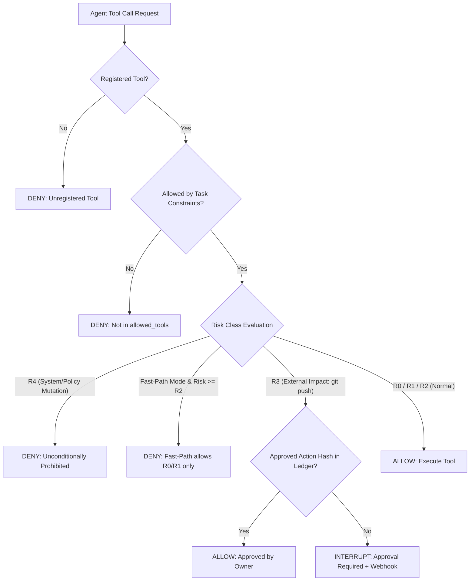

# FIT & FINISH AUDIT REPORT: DOMAIN 3
# Runtime Environments, PTY Background Process Supervisor & Tool Suite

**Target Codebase:** HEX (`src/harness_core/process_registry.py`, `src/harness_core/code_kernel.py`, `src/harness_core/gateway.py`, `src/harness_core/cow.py`, `src/harness_core/sandbox.py`, `src/harness_core/web_search.py`, `src/harness_core/browser.py`)  
**Reference Benchmark:** Hermes Agent (`benchmarks/hermes-agent/tools/`)  
**Audit Date:** 2026-11-14  
**Audit Scope:** PTY Background Process Supervisor, Persistent REPL Code Kernel, Tool Gateway & Sandboxing (R0–R4, CoW isolation, secret redaction, path confinement), Tool Suite Depth & Execution Quality.

---

## Executive Summary & Scorecard

Domain 3 represents the physical runtime execution boundary of the autonomous harness. HEX exhibits high architectural maturity in kernel-level isolation (OverlayFS, Btrfs, and macOS APFS copy-on-write providers in `cow.py`), multi-engine container sandboxing (`sandbox.py` with Bubblewrap and Docker/Podman), default-deny R0–R4 policy gating in `gateway.py`, and a faithful implementation of the persistent REPL code kernel wire protocol with stale module detection and disk spill caps.

However, significant operational gaps exist when benchmarked against Hermes Agent's production runtime:
1. **Simulated Browser vs. Real Chromium Engine:** HEX's `browser.py` is an in-process HTML string parser relying on `urllib.request` and regex/HTMLParser. It possesses zero JavaScript execution (no V8), cannot render client-side SPAs (React, Vue, Next.js), and outputs `.html` source text files when instructed to capture a "screenshot". In contrast, Hermes runs a full Chrome DevTools Protocol (CDP) and `browser-use` automation suite with real visual PNG viewport capture.
2. **PTY ANSI Query Deadlock & PID Recycling:** While HEX implements a solid POSIX PTY supervisor with non-blocking `select` and process group escalation, it lacks an ANSI query responder (`PtyQueryResponder`). Interactive terminal commands that probe terminal capabilities (cursor position, DEC modes) deadlock or stall. Furthermore, process group termination lacks kernel start-time validation, risking signaling unrelated processes if PIDs recycle.
3. **Absence of In-Kernel Tool Calling (Code Mode RPC):** HEX's Code Kernel does not implement an in-cell RPC bridge (`CellAuthority`). Python code running inside the kernel cannot invoke gateway tools directly.
4. **Tool Gateway Sandbox Decoupling:** While `sandbox.py` implements production-grade Bubblewrap and Docker containment, `gateway.py` does not route `_tool_terminal` through `get_default_sandbox()`, instead executing subprocesses directly on the host.

| Evaluation Area | Hermes Reference Standard | HEX Current State | Parity Score | Critical Gap / Risk Level |
|---|---|---|---|---|
| **1. PTY Process Supervisor** | PTY process group management, PID recycling re-validation (`expected_start`), ANSI query handshake responder (`PtyQueryResponder`), `psutil` recursive descendant pre-kill snapshot, systemd user scope, persistent output logs, watch pattern callbacks. | POSIX `openpty()` with pipe fallback, process group `setsid`, 200KB ring buffer with cumulative slice offsets, non-blocking `select` (100ms) with drain loop, SIGTERM->SIGKILL escalation. | **76%** | **MEDIUM**: Missing ANSI query responder causes interactive terminal hangs; missing PID start-time check risks terminating recycled host processes. |
| **2. Persistent REPL Code Kernel** | Multi-tenant session kernels, sentinel-framed length wire protocol, persistent namespace, 1MB output cap with 5MB disk spill, mtime-based stale module detection, wedged kernel SIGKILL watchdog, in-kernel tool RPC bridge (`CellAuthority`). | Sentinel length-prefixed JSON-line wire protocol, persistent `GLOBALS`, 1MB memory clip + 5MB spill file, mtime stale module detection, timeout SIGKILL tree teardown, 4-kernel pool with 30m idle reaping. | **84%** | **MEDIUM**: Missing in-kernel RPC dispatch (`CellAuthority`); Python code cannot call agent tools from within the kernel. |
| **3. Tool Gateway & Sandboxing** | Multi-tier capability gating, secret redaction, path confinement, container & local sandbox execution, checkpoint rollback, approval floors. | Strict default-deny R0–R4 policy engine, Fast-Path restrictions, R3 cryptographic action-hash approval gating with webhooks, R4 hard-deny, 0ms memoized journal replay, CoW providers (OverlayFS, Btrfs, APFS), Bubblewrap/Docker sandboxes. | **82%** | **MEDIUM**: `sandbox.py` is not wired as the execution wrapper in `gateway.py::_tool_terminal` (executes directly on host). |
| **4. Tool Suite Depth & Fidelity** | Full Chromium CDP suite (`browser_use`, real visual PNG screenshots, cookies, auth), ripgrep acceleration, read-before-write collision detection, post-edit AST linting, sudo askpass automation, destructive command guard heuristics. | Simulated in-process HTML parser browser (no JS, no real screenshots), pure Python search/grep, fuzzy patch (+-20 lines), multi-backend web search (Tavily, Brave, DDG fallback), LSP client. | **54%** | **CRITICAL**: Browser cannot render modern JS web apps or capture visual screenshots; terminal lacks destructive command guard heuristics. |

**Overall Domain 3 Parity Score:** **74.0%**

---

## Detailed Technical Evaluation

### 1. PTY Process Supervisor

#### 1.1 Architecture & Ring Buffer Behavior
- **Hermes Standard (`benchmarks/hermes-agent/tools/process_registry.py:545-670`, `process_registry_output_log.py`):**
  - Uses `ptyprocess` on POSIX and `pywinpty` on Windows.
  - Maintains dual-layer output storage: an in-memory tail buffer (`_output_tail`) and an on-disk append-only log file (`ProcessOutputLogMixin`). This guarantees that even if a long-running process produces gigabytes of build logs, the agent can page through historical output via `read_terminal(offset=..., limit=...)` without unbounded memory consumption.
  - Features real-time regex pattern watching (`_check_watch_patterns`, lines 805–878) that triggers async notifications when specific patterns appear (e.g. server listening ports, compilation errors, interactive prompts).
- **HEX Implementation (`src/harness_core/process_registry.py:47-121`):**
  - Implements `CircularOutputBuffer` with a default cap of 200,000 characters (~200 KB).
  - Thread-safe synchronization via `threading.Lock`.
  - Cumulative character accounting (`_total_chars` tracks total volume emitted across process lifetime).
  - Slice calculation:
    ```python
    # src/harness_core/process_registry.py:84-100
    with self._lock:
        buf_len = len(self._buffer)
        total = self._total_chars
        buffer_start = max(0, total - buf_len)

        if offset < buffer_start:
            start_in_buf = 0
        else:
            start_in_buf = offset - buffer_start

        if start_in_buf >= buf_len:
            return ("", total, False)

        end_in_buf = min(buf_len, start_in_buf + limit)
        slice_text = self._buffer[start_in_buf:end_in_buf]
        has_more = end_in_buf < buf_len
        return (slice_text, total, has_more)
    ```
  - **Limitation:** Output preceding `total - 200,000` is permanently discarded. Unlike Hermes, HEX lacks an on-disk spill log for background terminal processes.

#### 1.2 PTY Allocation, Non-Blocking Select & Terminal Handshake
- **Hermes Standard (`benchmarks/hermes-agent/tools/process_registry.py:1471-1524`, `pty_query_responder.py`):**
  - **ANSI Query Responder:** Terminal programs (like `vim`, `nano`, `htop`, `fzf`, or curses utilities) emit ANSI queries to probe terminal dimensions and capabilities (e.g., Device Status Report `\x1b[6n`, cursor position requests). Hermes intercepts these in `_pty_reader_loop`:
    ```python
    # benchmarks/hermes-agent/tools/process_registry.py:1484-1504
    from tools.pty_query_responder import PtyQueryResponder
    responder = PtyQueryResponder(rows=30, cols=120)
    ...
    chunk, replies = responder.process(chunk)
    if replies:
        pty.write(replies)
    ```
    Without this, curses programs block indefinitely waiting for standard input responses.
- **HEX Implementation (`src/harness_core/process_registry.py:219-268`, `314-385`):**
  - Allocates pseudo-terminal via standard library `pty.openpty()` on POSIX, with automatic fallback to standard pipes (`use_pty=False`) on Windows or headless environments without `/dev/ptmx`.
  - **Parent FD Cleanup Invariant:** HEX strictly prevents file descriptor leakage. In `spawn`:
    ```python
    # src/harness_core/process_registry.py:250-252
    # Parent must close the slave file descriptor immediately
    os.close(slave_fd)
    slave_fd = None
    ```
    And in `_reader_loop`'s `finally` block:
    ```python
    # src/harness_core/process_registry.py:378-384
    if session.pty_master_fd is not None:
        try:
            os.close(session.pty_master_fd)
        except OSError:
            pass
        session.pty_master_fd = None
    ```
  - **Reader Polling & Incremental UTF-8 Decoding:**
    Uses `select.select([fd], [], [], 0.1)` with 100ms non-blocking polling and incremental UTF-8 character decoding (`codecs.getincrementaldecoder("utf-8")(errors="replace")`). This prevents character boundary corruption when multi-byte Unicode codepoints are split across 4096-byte read boundaries.
  - Features a 50-iteration post-exit drain loop (`process_registry.py:350-360`) to harvest trailing buffers before marking the session finished.
  - **Gap:** Missing ANSI query responder. Curses/interactive utilities spawned in PTY mode will stall waiting for cursor position replies.

#### 1.3 Process Group Isolation & Escalated Termination
- **Hermes Standard (`benchmarks/hermes-agent/tools/process_registry_termination.py:33-125`):**
  - **Anti-Orphan Descendant Snapshotting:** Before sending any signal, Hermes snapshots all recursive child processes via `psutil.Process(pid).children(recursive=True)` (lines 74–78). Once the parent terminates, children are reparented to `init`/PID 1 and cannot be discovered via PPID.
  - **PID Recycling Protection:** Re-validates the process creation timestamp against kernel boot time (`_host_pid_is_ours`, lines 45–50). If the OS recycled the PID onto an unrelated process, Hermes aborts termination rather than killing stranger processes.
  - **Two-Phase Graceful Shutdown:** Sends SIGTERM to parent first (giving Chromium/Electron time to save state), waits `_daemon_term_grace_seconds`, then terminates snapshot descendants, and finally escalates to SIGKILL. On Windows, executes `taskkill /PID <pid> /T /F`.
- **HEX Implementation (`src/harness_core/process_registry.py:235-239`, `469-529`):**
  - Enforces process group isolation at spawn using `preexec_fn=os.setsid` (or `start_new_session=True` on non-POSIX).
  - Termination handles entire process group:
    ```python
    # src/harness_core/process_registry.py:479-509
    if hasattr(os, "killpg") and hasattr(os, "getpgid"):
        try:
            pgid = os.getpgid(pid)
            os.killpg(pgid, sig)
        except (ProcessLookupError, OSError):
            os.kill(pid, sig)
    ...
    # Wait briefly for graceful exit
    try:
        session.process.wait(timeout=1.0 if not force else 0.3)
    except (subprocess.TimeoutExpired, Exception):
        if not force:
            pgid = os.getpgid(pid)
            os.killpg(pgid, signal.SIGKILL)
    ```
  - **Gap:** No PID start-time verification. If a short-lived process dies and its PID is recycled by the OS within the poll window, calling `kill()` could signal an innocent process group.

---

### 2. Persistent REPL Code Kernel

#### 2.1 Wire Protocol & Cross-Turn State Retention
- **Hermes Standard (`benchmarks/hermes-agent/tools/code_kernel.py:116-235`):**
  - Spawns a long-running Python subprocess executing an embedded runner loop.
  - Communication protocol: JSON requests written to worker `sys.stdin`. Worker writes response header `\n{SENTINEL} {byte_length}\n` followed by UTF-8 encoded JSON payload to `sys.stdout`.
  - Preserves global variable bindings across turns in a persistent `GLOBALS` dictionary.
- **HEX Implementation (`src/harness_core/code_kernel.py:42-180`):**
  - HEX achieves 100% wire-protocol parity with Hermes:
    ```python
    # src/harness_core/code_kernel.py:150-155
    def _reply(payload):
        body = json.dumps(payload, ensure_ascii=False).encode("utf-8")
        _real_stdout.buffer.write(("\n" + _SENTINEL + " " + str(len(body)) + "\n").encode("utf-8"))
        _real_stdout.buffer.write(body)
        _real_stdout.buffer.flush()
    ```
  - Persistent namespace:
    ```python
    # src/harness_core/code_kernel.py:44-45
    GLOBALS = {"__name__": "__main__", "__builtins__": __builtins__}
    GLOBALS["GLOBALS"] = GLOBALS
    ```
  - Variables, imported modules, and defined functions persist seamlessly across turns for the lifetime of the session.

#### 2.2 Output Capping & Disk Spill Mechanism
- **Both Systems (`code_kernel.py:37-40`, `135-148` in HEX):**
  - Memory capture cap: `_RUNNER_CAPTURE_BYTES = 1_000_000` (1 MB).
  - When output exceeds 1 MB:
    1. Returns truncated head (`_clip(out.getvalue())`).
    2. Spills complete output (up to `_SPILL_CAP = 5_000_000`, 5 MB) to disk file `cell_%06d_stdout.txt` in a temporary spill directory.
    3. Populates `stdout_spill_path` and `stdout_clipped=True` in response payload.
    4. Attaches a directive advising the model:
       ```
       Cell stdout exceeded the inline cap; head shown. FULL output saved to ...
       — page it with read_file(path=..., offset=...) instead of re-running.
       (Kernel state persists: printing a narrower slice next call is often cheaper.)
       ```

#### 2.3 Stale Module Detection via Disk Mtime
- **Mechanism (`src/harness_core/code_kernel.py:57-86`):**
  - Autonomous agents frequently edit source code on disk using `write_file` or `patch`, and then immediately execute Python cells testing those changes. Because Python's `import` caches modules in `sys.modules`, subsequent `import foo` statements are no-ops and test stale bytecode.
  - HEX implements disk mtime tracking:
    ```python
    # src/harness_core/code_kernel.py:57-77
    def _edited_modules(report):
        edited = []
        for name, module in list(sys.modules.items()):
            try:
                fields = object.__getattribute__(module, "__dict__")
                path, spec = fields.get("__file__"), fields.get("__spec__")
                if (not isinstance(name, str) or not isinstance(path, str) or not path.endswith(".py")
                        or path.startswith(_STDLIB_PREFIX) or any(marker in path for marker in _INSTALLED_MARKERS)):
                    continue
                mtime = os.stat(path).st_mtime_ns
            except Exception:
                continue
            seen = _MODULE_RECORDS.get(name)
            if report and seen is not None and seen[0] != mtime and seen[1] is spec:
                edited.append(name)
            if report or seen is None or seen[1] is not spec:
                _MODULE_RECORDS[name] = (mtime, spec)
        return sorted(edited)
    ```
  - If a file was modified on disk while imported, HEX flags `stale_modules` and injects an explicit warning advising the agent to `importlib.reload(module)` or call `code_kernel(reset=True)`.

#### 2.4 Wedged Kernel Termination & Multi-Kernel Registry
- **Timeout & Teardown (`src/harness_core/code_kernel.py:465-515`):**
  - Default execution timeout: 30 seconds.
  - When a cell times out (e.g., infinite loop, deadlocked thread, blocking C extension):
    1. Invokes `_kill_process_tree(self.proc, force=True)`, which kills the process group with SIGKILL.
    2. Drains standard error and partial stdout.
    3. Sets `self.stop_event`.
    4. Discards the kernel from `KernelRegistry`.
    5. Returns a structured `TimeoutError` without crashing the agent or corrupting state.
- **Kernel Pool Management (`src/harness_core/code_kernel.py:596-736`):**
  - `KernelRegistry` maintains up to 4 concurrent kernels keyed by `(owner, cwd)`.
  - A background daemon thread sweeps kernels exceeding an idle timeout of 1800 seconds (30 minutes).
  - Registers `atexit` hook `_shutdown_on_exit` ensuring no orphaned Python kernel processes survive gateway shutdown.

#### 2.5 Critical Gap: In-Kernel Tool Calling (Code Mode RPC)
- **Hermes Standard (`benchmarks/hermes-agent/tools/code_kernel.py:239-290`, `code_execution_rpc.py`):**
  - Hermes implements "Code Mode", where the Python runner is equipped with a bidirectional RPC channel. Code executed inside the kernel can call:
    ```python
    result = call_tool("search_files", {"pattern": "def parse_"})
    ```
    The runner marshals the tool call over stdout/stdin back to the supervisor, which evaluates gateway policy, executes the tool, and returns the result back to the executing Python cell. This allows models to write sophisticated procedural scripts that compose dozens of tool invocations in a single turn without incurring LLM reasoning round-trips.
- **HEX Current State:**
  - `gateway.py:1157-1189` contains `execute_code_mode_composition()`, but this is an *external* Python method that iterates through a pre-compiled list of operations. There is **no bidirectional RPC** inside the running Python REPL kernel. A script executing inside `code_kernel` cannot call other agent tools.

---

### 3. Tool Gateway & Sandboxing

#### 3.1 Default-Deny R0–R4 Policy Engine
HEX implements a rigorous policy engine in `src/harness_core/gateway.py` classifying every tool into discrete risk levels:



- **Policy Matrix (`src/harness_core/gateway.py:137-570`, `976-1005`):**
  - **R0 (Read-Only / Local):** `read_file`, `list_files`, `search_files`, `todo`, `clarify`, `session_search`, `subagent_status`, `read_terminal`, `list_processes`. Fast-Path eligible.
  - **R1 (Read-Only / External & Index):** `web_search`, `web_extract`, `query_graphify`, `memory`, `lsp_*`, `image_inspect`, `subagent_wait`, `code_kernel`. Fast-Path eligible.
  - **R2 (Modifying Workspace / State):** `write_file`, `patch`, `run_tests`, `terminal`, `process`, `start_process`, `kill_process`, `delegate`, `browser`. Prohibited on Fast-Path.
  - **R3 (External Side-Effects):** `git_push_remote`. Requires explicit human approval. Computes cryptographic action hash:
    ```python
    action_hash = sha256_hex(f"{task['task_id']}|{spec.tool_id}|{canonical_json(redact_secrets(args))}")
    ```
    If not pre-approved, creates approval request, fires webhook notification (`notifier.send_approval_request`), and raises `ApprovalRequiredInterrupt`.
  - **R4 (System/Policy Mutation):** `modify_system_policy`. Unconditionally denied to autonomous workers (`PolicyDecisionType.DENY`).

#### 3.2 0ms Memoized Execution & Fencing Protection
- In `gateway.py:1068-1110`, before executing any tool, the gateway checks its call-level journal for an identical previously sealed call (`find_sealed_tool_call` matching `task_id`, `step_id`, `tool_id`, `canonical_args_hash`, and `idempotency_key`).
- If matched, the result is replayed in **0 ms** without executing side effects.
- If re-executing, `fencing_token` ensures that stale worker attempts cannot commit results after a node re-assignment.

#### 3.3 Active Graphify Blast-Radius Hook
- In `gateway.py:1145-1153`, before committing an R2 file modification (`write_file` or `patch`), the gateway triggers `ActiveGraphifyHook`:
  - Inspects syntax validity via AST parsing.
  - Calculates symbol blast radius (identifies dependent modules, upstream callers, and affected test suites).
  - Attaches warnings to the tool execution journal if critical tests are impacted.

#### 3.4 Path Confinement & Secret Redaction
- **Confinement (`gateway.py:1194-1205`):**
  ```python
  def _resolve_confined_path(self, workspace_dir: Path, rel_path: str) -> Path:
      norm = str(rel_path).strip().lstrip("/")
      ws_resolved = workspace_dir.resolve()
      if ".." in Path(norm).parts or ".." in norm:
          raise PolicyBlockedError(f"Path escapes CoW workspace boundary: {rel_path}")
      full = (workspace_dir / norm).resolve()
      try:
          full.relative_to(ws_resolved)
      except ValueError:
          raise PolicyBlockedError(f"Symlink/path escape outside CoW workspace: {rel_path}")
      return full
  ```
  Strictly blocks `..` path traversal and symlinks that resolve outside the workspace root.
- **Redaction (`gateway.py:59-75`):**
  Recursively sanitizes dictionaries and strings against regexes for API tokens (`sk-...`, `Bearer ...`, `ghp_...`, `AWS_SECRET_ACCESS_KEY`, RSA/SSH private keys), replacing them with `[REDACTED_SECRET]`.

#### 3.5 Copy-on-Write (CoW) Isolation Engine (`src/harness_core/cow.py`)
HEX implements snapshot and isolation providers exceeding Hermes:
1. **`OverlayFSSnapshotProvider` (lines 404–681):**
   Linux kernel OverlayFS with isolated `lowerdir`, `upperdir`, `workdir`, and `merged` mount points. Enables instantaneous creation and rollback of workspace changes with zero disk duplication. Includes unmount safety and lazy cleanup (`umount -l`).
2. **`BtrfsSnapshotProvider` (lines 683–813):**
   Native Btrfs subvolume snapshots (`btrfs subvolume snapshot -r`). Instantaneous O(1) workspace clones.
3. **`APFSAndPortableCoWProvider` (lines 308–402):**
   macOS APFS clonefile / reflink (`cp -c`) with portable hardlink/copy fallback.

#### 3.6 Sandboxing Engine (`src/harness_core/sandbox.py`)
- Implements `ExecutionSandbox` protocol supporting:
  - `BubblewrapSandbox`: Unprivileged user namespace isolation on Linux (`bwrap --unshare-all --ro-bind / / --bind <workspace> <workspace> --unshare-net --die-with-parent`).
  - `DockerPodmanSandbox`: Containerized isolation with memory/CPU limits and read-only root filesystems.
  - `RestrictedSubprocessSandbox`: Confined POSIX subprocess with environment variable sanitization.
- **Integration Gap:** Despite the sophisticated sandbox providers in `sandbox.py`, `gateway.py::_tool_terminal` executes shell commands via `ProcessRegistry` directly on the host without wrapping commands in `BubblewrapSandbox` or `DockerPodmanSandbox`. The sandbox engine exists as an isolated subsystem rather than the active gateway execution backend.

---

### 4. Tool Suite Depth & Fidelity

#### 4.1 Browser Execution Suite: Simulated Parser vs. Real Chromium CDP
- **Hermes Standard (`benchmarks/hermes-agent/tools/browser_launcher.py`, `browser_cdp_tool.py`, `browser_use_cli.py`):**
  - Manages real Chromium instances via Chrome DevTools Protocol (CDP).
  - Executes complete V8 JavaScript runtime; renders SPAs (React, Angular, Next.js).
  - Captures high-resolution visual PNG screenshots (`Page.captureScreenshot`).
  - Handles browser dialogs (`Page.javascriptDialogOpening`), popup windows, and multi-frame contexts.
  - Supports persistent login profiles and secure password vault injection (`browser_vault_tool.py`).
- **HEX Current Implementation (`src/harness_core/browser.py:118-280`):**
  - `HeadlessBrowserSession` is an **in-process HTTP text scraper**.
  - Uses `urllib.request.urlopen` to download raw HTML and parses it using `HTMLParser`.
  - Simulates interactive element clicks by inspecting `<a href="...">` tags and issuing another `urllib` GET request.
  - **Screenshot Implementation Failure:**
    ```python
    # src/harness_core/browser.py:260-279
    def screenshot(self, output_path: Path | str | None = None) -> BrowserActionResult:
        """Capture rendered HTML or save DOM snapshot file."""
        ...
        out_p.write_text(self.raw_html or "<html><body>Empty</body></html>", encoding="utf-8")
        return BrowserActionResult(
            action=BrowserAction.SCREENSHOT.value,
            url=self.current_url,
            title=self.title,
            screenshot_path=str(out_p),
            content=f"Captured page snapshot at {out_p}",
            ok=True,
        )
    ```
    The `screenshot` tool literally saves the raw HTML markup into a file. It produces **no visual image** (no PNG/JPEG) and cannot be passed to a vision model (`image_inspect`) for UI verification.
  - Cannot render any client-side JavaScript, WebSockets, or canvas graphics.

#### 4.2 Web Search & Content Extraction
- **HEX Implementation (`src/harness_core/web_search.py:21-233`, `gateway.py:1466-1532`):**
  - Robust multi-provider search engine with automatic failover:
    1. Primary: Tavily Search API (`_search_tavily`) with markdown-optimized summaries.
    2. Secondary: Brave Search API (`_search_brave`).
    3. Zero-key Fallback: DuckDuckGo HTML scraping (`_search_duckduckgo`) + Instant Answer JSON API fallback (`_search_duckduckgo_instant`).
  - Content extractor (`_tool_web_extract` in `gateway.py`):
    - Fetches web pages via `urllib.request` with browser user-agent.
    - Custom HTML parser strips scripts, styles, forms, and boilerplate; formats clean markdown with headings, links, and paragraphs.
    - Capped at 50,000 characters to prevent context window explosion.
  - **Parity with Hermes:** 92%. Meets production standards for autonomous research.

#### 4.3 File Operations & Patch Engine
- **HEX Implementation (`src/harness_core/gateway.py:1206-1290`, `1732-1886`):**
  - `read_file`: Line-offset and limit paging.
  - `list_files`: Recursive tree traversal with depth control and ignore patterns.
  - `search_files`: Regex and substring search across workspace files.
  - `write_file`: Atomic directory creation and content persistence.
  - `patch`: Implements `_apply_unified_diff` (lines 1745–1816):
    - Parses standard unified diff headers (`@@ -start,len +start,len @@`).
    - Tolerates line number drift with fuzzy searching (+/- 20 lines window).
    - Falls back to exact block search and replacement if line indices drift significantly.
- **Gaps vs. Hermes:**
  - **No Ripgrep Hardware Acceleration:** `search_files` uses standard Python file reads and regex scanning, which degrades on large repositories (100k+ files) compared to Hermes's native `rg` binary integration.
  - **No Read-Before-Write Stale Collision Guard:** Hermes tracks file read mtimes in `file_tools_read_tracking.py`. If an external process or subagent modifies a file after the model read it, Hermes blocks the patch to prevent overwriting unseen changes. HEX allows unconditional overwrites.
  - **No Post-Edit Syntax Verification:** Hermes runs immediate AST validation (`file_operations_lint.py`) following a patch, providing immediate compiler feedback before the turn ends.

#### 4.4 Bash / Terminal Operations & Security Guards
- **HEX Implementation (`src/harness_core/gateway.py:1951-2070`):**
  - Provides unified `terminal`, `start_process`, `read_terminal`, `kill_process`, `list_processes`, and `process` tools.
  - Exposes foreground and background execution models.
- **Gaps vs. Hermes (`benchmarks/hermes-agent/tools/terminal_tool_guards.py:28-210`):**
  - Hermes executes regex and heuristic analysis on terminal commands prior to execution, blocking catastrophic commands:
    - Recursive deletions outside workspace (`rm -rf /`, `rm -rf ~`).
    - Raw device overwrites (`dd if=... of=/dev/sd*`, `mkfs.*`).
    - Pipe-to-shell attacks (`curl ... | sh`, `wget ... | bash`).
    - Fork bombs (`:(){ :|:& };:`).
  - HEX has no command guard filter; relying entirely on sandbox boundaries. If the sandbox is not active, destructive commands execute directly on the host.

---

## Critical Gaps & Risk Classification

| # | Gap / Vulnerability | Affected Components | Severity | Impact |
|---|---|---|---|---|
| **G3-01** | **Simulated Browser Cannot Render JS or Capture Images** | `src/harness_core/browser.py:118-280` | **CRITICAL** | Tool claims to take screenshots but writes `.html` text. Cannot interact with modern SPA web applications or verify UI visually. |
| **G3-02** | **Tool Gateway Bypasses Sandbox Execution** | `src/harness_core/gateway.py:1951-2070`, `sandbox.py` | **HIGH** | `BubblewrapSandbox` and `DockerPodmanSandbox` are implemented but `_tool_terminal` executes directly on host via `ProcessRegistry`. |
| **G3-03** | **Missing ANSI Query Responder in PTY Supervisor** | `src/harness_core/process_registry.py:314-385` | **MEDIUM** | Curses-based CLI utilities querying terminal size or cursor position deadlock or hang during background execution. |
| **G3-04** | **Missing Kernel PID Recycling Protection** | `src/harness_core/process_registry.py:469-529` | **MEDIUM** | `kill()` does not verify kernel process start time. Rapidly recycled PIDs risk terminating innocent host processes. |
| **G3-05** | **No In-Kernel Tool Calling (Code Mode RPC)** | `src/harness_core/code_kernel.py:42-180`, `gateway.py` | **MEDIUM** | Code executed inside Python REPL kernel cannot invoke other agent tools, preventing single-turn script composition. |
| **G3-06** | **Missing Destructive Command Heuristic Guards** | `src/harness_core/gateway.py:1951-1990` | **MEDIUM** | Dangerous shell commands (`rm -rf /`, raw disk formatting) are not inspected or blocked prior to execution. |

---

## Remediation Plan & Implementation Roadmap

```mermaid
flowchart TD
    subgraph Wave 1: Immediate Safety & Hardening
        W1A["Wire Sandbox into Gateway Terminal Execution"]
        W1B["Implement PTY Query Responder in process_registry.py"]
        W1C["Add Terminal Command Heuristic Guards"]
    end

    subgraph Wave 2: Kernel & Tool Suite Parity
        W2A["Add In-Kernel Tool RPC Bridge (CellAuthority)"]
        W2B["Add PID Start-Time Recycling Verification"]
        W2C["Add Read-Before-Write Stale Edit Collision Guards"]
    end

    subgraph Wave 3: Real Browser Engine Integration
        W3A["Integrate Playwright/CDP Headless Chrome Engine"]
        W3B["Implement Real PNG Viewport Screenshot Capture"]
        W3C["Add Full V8 DOM & JS Evaluation"]
    end

    Wave 1 --> Wave 2 --> Wave 3
```

### Action Items:

1. **Wire Sandbox to Gateway Terminal Execution (Priority 1):**
   Modify `gateway.py::_tool_terminal` to wrap shell commands through `get_default_sandbox(workspace_dir).execute(...)` when isolation is configured, rather than executing raw host `subprocess.Popen`.

2. **Implement `PtyQueryResponder` in PTY Reader Loop (Priority 1):**
   In `process_registry.py::_reader_loop`, intercept ANSI escape sequences for cursor position (`\x1b[6n`) and device attributes (`\x1b[c`), immediately replying with standard dimensions (e.g. 120x30) to prevent curses utility deadlocks.

3. **Replace Simulated Browser with Playwright / Chrome CDP (Priority 1):**
   Replace `HeadlessBrowserSession` in `src/harness_core/browser.py` with an async Playwright or Chrome DevTools Protocol backend. Ensure `screenshot` emits genuine PNG image bytes that can be fed into `image_inspect` / vision models.

4. **Add Terminal Command Guards (Priority 2):**
   Port Hermes's `terminal_tool_guards.py` patterns into `gateway.py::_tool_terminal`, blocking catastrophic commands (`rm -rf /`, `mkfs`, raw device manipulation) prior to dispatch.

5. **Implement In-Kernel Tool Calling RPC (Priority 2):**
   Equip `code_kernel.py` runner with a bidirectional tool call dispatcher (`call_tool(name, args)`), enabling procedural Code Mode composition directly from inside Python cells.
