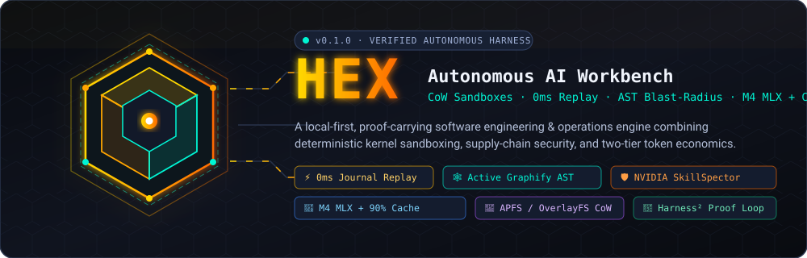
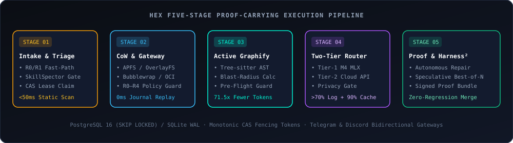

<div align="center">



<br />

[](pyproject.toml)
[](pyproject.toml)
[-10b981?style=flat-square&logo=pytest&logoColor=white)](AUDIT_REPORT.md)
[](src/harness_core/providers/antigravity_provider.py)
[](vendor/skillspector/README.md)
[-00f5d4?style=flat-square)](vendor/graphify/README.md)
[](vendor/harness2/README.md)
[](pyproject.toml)

**A local-first, proof-carrying autonomous software engineering and operations workbench.**  
*Zero-copy CoW sandboxes · 0ms journaled tool replay · Polyglot AST blast-radius & work-memory reflection · Day-1 Google Antigravity OAuth quota + M4 MLX compression.*

[**Quickstart**](#-30-second-quickstart) · [**Interactive TUI**](#️-interactive-tui--hermes-grade-cockpit) · [**Architecture**](#️-5-stage-proof-carrying-architecture) · [**Graphify AST & Memory**](#-coherent-graphify-ast--work-memory-engine) · [**Antigravity & Token Economics**](#-day-1-google-antigravity-quota--token-economics) · [**CLI & Diagnostics**](#️-complete-cli--self-healing-diagnostics-surface) · [**Security & API**](#️-supply-chain-security--distributed-control-plane) · [**Audit Report**](AUDIT_REPORT.md)

</div>

---

> [!IMPORTANT]
> **Why HEX Exists:** Conventional coding agents (`OpenClaw`, `Hermes Agent`, shell-wrapper loops) mutate your working tree in place, re-execute expensive tool calls from scratch after crashes, dump entire 1,500-line source files and 50 KB test tracebacks into frontier cloud APIs, and store flat text memories that silently go stale when code changes. **HEX** replaces best-effort chat loops with a **transactional, kernel-sandboxed, AST-and-memory-coherent state machine** that proves every patch passes verification before touching your mainline branch.

---

## ⚡ See It in Action

<div align="center">
  
</div>

---

## 🚀 30-Second Quickstart

### 1. Install `hex` on Any Device

**Method A: One-Line Universal Installer (macOS & Linux)**
```bash
curl -fsSL https://raw.githubusercontent.com/Stewy8506/Harness/main/install.sh | bash
```

**Method B: Via `pipx` or `uv tool` (Zero-Pollution Isolated CLI)**
```bash
# Using pipx
pipx install "git+https://github.com/Stewy8506/Harness.git[tui]"

# Or using astral uv
uv tool install "git+https://github.com/Stewy8506/Harness.git[tui]"
```

**Method C: Direct Pre-Built Wheel (GitHub Releases)**
```bash
# Download and install the latest universal wheel
pip install "https://github.com/Stewy8506/Harness/releases/latest/download/hex_ai-0.1.0-py3-none-any.whl"
```

**Method D: From Source Checkout**
```bash
git clone https://github.com/Stewy8506/Harness.git
cd Harness
./install.sh
```

### 2. Zero-Friction First-Run Auto-Setup & Antigravity Quota

If launching HEX on a clean machine without configured API keys, running bare `hex` (or `hex chat`) automatically intercepts boot and presents the **interactive terminal arrow-key setup wizard** (`↑`/`↓`, `[•]` selection, masked API keys):

```text
◈ Welcome to HEX — Autonomous AI Workbench
  No model provider or API key was detected. Select your primary brain:

  [•] Connect Google Antigravity OAuth ($0 Day-1 Free Tier / Auto-detect IDE session)
  [ ] Enter Anthropic API Key (Claude 3.5 Sonnet / Opus)
  [ ] Enter OpenAI API Key (GPT-4o / o1 / o3-mini)
  [ ] Enter Google Gemini API Key (Gemini 2.5 Pro / Flash)
  [ ] Use Local Offline Model (Apple Silicon MLX / Ollama — Zero egress)
```

The 4-step setup wizard configures:
1. **Primary Model Brain & Live Model Discovery**: Authenticates first (auto-detects local Google Antigravity OAuth sessions, browser PKCE OAuth flow, or validates API keys), then queries provider endpoints live (`fetchAvailableModels`, `/v1/models`, `/v1beta/models`, `/api/tags`) with strict 3.0s timeouts and resilient offline fallback badging (`[offline fallback]`).
2. **Autonomous Web Search Engine**: Zero-key DuckDuckGo (free, instant), Tavily Search API, Brave Search API, or Air-gapped (Disabled).
3. **Remote Messaging & Bot Gateways**: Telegram Bot token + allowed user IDs, Discord Bot token + webhook, or Skip.
4. **Machine Hardware & Isolation**: Auto-detects APFS clonefiles / Linux OverlayFS and sandbox profile.
Credentials and configs are saved securely to `~/.hex/credentials.env` (chmod 0600) and `~/.hex/config.yaml`, and injected into `os.environ` in real time.

```bash
# Explicitly run interactive setup wizard at any time (alias: hex onboard):
hex setup

# Manage persistent global project registry and switch workspace context:
hex project list
hex project add /path/to/my-repo
hex project use my-repo
hex project switch

# Import local Antigravity IDE OAuth session & inspect live quota windows:
hex auth antigravity --import-ide --status
hex quota

# Run 8-category system health diagnostics & auto-remediate missing dirs/configs:
hex doctor --fix

# Build persistent polyglot AST & dependency cache (.hex/graph.json):
hex init .

# Launch the 24-bit TrueColor interactive TUI cockpit (or just run 'hex'):
hex --skin amber
```

### 3. Dispatch Autonomous Tasks, Search History, or Inspect Recipes

```bash
# Auto-detect project bootstrap, build, test, and start lifecycle commands
hex recipe

# Execute an autonomous task with Git auto-branching and Pull Request generation
hex run "Refactor router.py to support cloud log compression" --provider antigravity --branch --pr

# Search across all historical tasks, tool call transcripts, and logs via SQLite FTS5 BM25
hex search "router compression"

# Run deterministic Graphify work-memory reflection (.hex/reflections/LESSONS.md)
hex reflect
```

---

## 🏗️ 5-Stage Proof-Carrying Architecture

<div align="center">
  
</div>

<br />

HEX integrates three battle-tested upstream engines directly into [`src/harness_core/`](src/harness_core) (vendored and detached from `.git` for 100% air-gapped reproducibility):

| Subsystem | Engine / Module | What It Guarantees |
| :--- | :--- | :--- |
| **1. Supply-Chain Quarantine** | [`vendor/skillspector`](vendor/skillspector/README.md) → [`skillspector.py`](src/harness_core/skillspector.py) | Blocks prompt-injected skills, malicious hooks, Pickle/exec payloads, and OSV CVEs in **<50ms** (static) and **<2s** (M4 semantic) with **100% quarantine recall**. |
| **2. CoW Workbench & Sandbox** | [`cow.py`](src/harness_core/cow.py) + [`sandbox.py`](src/harness_core/sandbox.py) | Instant zero-copy filesystem clones via **macOS APFS (`cp -c -R`)**, **Linux OverlayFS**, or **Btrfs**, isolated inside **Bubblewrap (`bwrap`)**, **rootless Docker/Podman**, or sanitized subprocesses. |
| **3. 0ms Call-Level Journal** | [`gateway.py`](src/harness_core/gateway.py) | Hashes `(tool_name, canonical_args, snapshot_id)`. Crashed or resumed tasks replay prior tool calls from the journal in **0ms (<15ms SLA)** without re-executing side effects. |
| **4. Active Graphify AST & Work-Memory** | [`vendor/graphify`](vendor/graphify/README.md) → [`graphify.py`](src/harness_core/graphify.py) + [`router.py`](src/harness_core/router.py) | Persistent `<10ms` polyglot AST graph (`.hex/graph.json`), surgical symbol slicing (`75%–90%` fewer repair tokens), circular import gate, and SHA-256 staleness-checked work-memory reflections (`LESSONS.md`). |
| **5. Two-Tier Router + Antigravity Quota** | [`antigravity_provider.py`](src/harness_core/providers/antigravity_provider.py) + [`mlx_provider.py`](src/harness_core/providers/mlx_provider.py) + [`cloud_provider.py`](src/harness_core/providers/cloud_provider.py) | Routes Tier-2 reasoning through your included **Google Antigravity OAuth quota ($0 marginal API billing)** or Anthropic/OpenAI/Gemini with `90%` prefix caching, paired with Tier-1 Apple Silicon M4 MLX (`>70%` log compression). |
| **6. Speculative Tree-of-Worktrees & Harness²** | [`vendor/harness2`](vendor/harness2/README.md) → [`proof.py`](src/harness_core/proof.py) | Forks $N$ parallel CoW snapshots for competing synthesis strategies, runs verification suites in parallel, and promotes only the verified winner (`ProofArtifact`). |

---

## 🧠 Coherent Graphify AST & Work-Memory Engine

Unlike agents that treat AST indexing, session memory, and full-text search as disconnected silos, HEX unifies [`src/harness_core/graphify.py`](src/harness_core/graphify.py), [`GovernedMemoryService`](src/harness_core/router.py), and [`TaskSearchIndex`](src/harness_core/search.py) around a single canonical `.hex/graph.json` knowledge graph:

1. **Persistent `<10ms` Incremental Stat Cache & Unified Node-Link Graph (`.hex/graph.json`)**
   - Tracks per-file `(mtime_ns, size, sha256)` signatures so warm reloads complete in **`<10ms`** with `100%` cache hits, re-parsing only the exact files modified during a task.
   - Emits both fast per-file symbol tables and standard NetworkX `"nodes"` + `"links"` arrays (with `.hex/.graphify_root`) so every upstream [`vendor/graphify`](vendor/graphify/README.md) analyzer works out of the box.
2. **Polyglot Full-Stack AST Indexing**
   - Indexes Python (`.py`), TypeScript/React (`.ts`, `.tsx`), JavaScript (`.js`, `.jsx`, `.mjs`), Rust (`.rs`), and Go (`.go`) functions, classes, React components, structs, enums, `impl` blocks, and cross-file imports.
3. **Surgical AST Symbol Slicing (`extract_surgical_context`)**
   - During autonomous repair ([`HarnessOrchestrator.generate_repair_patch()`](src/harness_core/orchestrator.py)), instead of dumping entire 1,500-line files into the prompt, Graphify slices **only the failing/mutated symbol spans (`lineno..end_lineno`) + module imports + 1-hop caller signatures**, cutting repair prompt tokens by **75%–90%**.
4. **Zero-Token Architectural Topology & Circular Import Gate (`analyze_architecture`)**
   - Invokes [`graphify.analyze.god_nodes`](vendor/graphify/graphify/analyze.py), `find_import_cycles`, `surprising_connections`, and `graph_diff` at **0 LLM tokens**—injecting a 200-token architecture map into the cached prompt prefix and flagging any patch that introduces circular file dependencies.
5. **AST-Anchored Work-Memory Reflection & SHA-256 Staleness Detection (`reflect_work_memory`)**
   - Every episodic and project memory recorded in [`GovernedMemoryService`](src/harness_core/router.py) is anchored to specific AST `source_nodes` alongside the **SHA-256 fingerprint of their source files** (`code_fingerprints`) and an outcome signal (`useful`, `dead_end`, or `corrected`).
   - Upstream [`graphify.reflect`](vendor/graphify/graphify/reflect.py) aggregates these outcomes with a **30-day time-decay half-life** and corroboration threshold (`min_corroboration=2`) into `.hex/reflections/LESSONS.md` (**Preferred sources**, **Tentative**, **Contested**, **Known dead ends**, **Corrections**) and `.hex/.graphify_learning.json`.
   - If a source file is later modified, any memory citing symbols in that file is automatically marked `stale="true"` (`[STALE - CODE CHANGED]`) so the agent never relies on outdated architectural assumptions.
6. **Interactive D3 v7 Architecture Tree Export (`export_interactive_html`)**
   - Run `/blast --html` in the TUI to generate a self-contained, zoomable D3 v7 collapsible module and symbol tree at `.hex/architecture_tree.html`.

---

## 💰 Day-1 Google Antigravity Quota & Token Economics

HEX connects directly to your **Google Antigravity OAuth quota** (Google AI Pro, Ultra, or Individual plans) from Day 1 via [`AntigravityModelProvider`](src/harness_core/providers/antigravity_provider.py), while multiplying your effective quota capacity by **5x–10x**:

```
┌────────────────────────────────────────────────────────────────────────────────────────┐
│  1. $0 Day-1 Antigravity OAuth   Auto-discovers IDE state.vscdb / Keychain / PKCE auth │
│  2. $0 AST Graph & Slicing       Surgical symbol slicing cuts file context by 75%–90%  │
│  3. >70% Log Compression         Tier-1 M4 MLX (or Flash/Haiku) strips stacktrace noise│
│  4. 90% Prefix Cache Hit         Stable System + AST + Lessons pinned in prefix cache  │
│  5. 0-Token Crash Replay         Resumed runs replay tool outputs from SQLite/PG ledger│
└────────────────────────────────────────────────────────────────────────────────────────┘
```

### Multi-Source Antigravity OAuth Discovery
`AntigravityOAuthManager` automatically discovers and refreshes your `ya29.*` access token and `1//*` refresh token across:
1. Environment variables (`HEX_ANTIGRAVITY_TOKEN`, `ANTIGRAVITY_OAUTH_TOKEN`, `HEX_ANTIGRAVITY_REFRESH_TOKEN`)
2. HEX's encrypted/restricted credential store (`~/.hex/antigravity_auth.json`, `chmod 0600`)
3. Local **Google Antigravity IDE SQLite database** (`state.vscdb` → `antigravityUnifiedStateSync.oauthToken`, including nested Base64 decoding)
4. Existing OpenCode / PicoClaw auth stores (`~/.config/opencode/antigravity-accounts.json`, `~/.picoclaw/auth.json`)
5. macOS Keychain (`security find-generic-password`) or interactive OAuth 2.0 PKCE login (`hex auth antigravity --auth-url`)

### Empirical Token Reduction Benchmarks

| Corpus / Workload | Raw Input | HEX Compressed | Token Reduction | Mechanism |
| :--- | ---: | ---: | ---: | :--- |
| **52-file Mixed Repository** | 418,400 tok | **5,850 tok** | **71.5x fewer tokens** | Local Graphify AST graph + Leiden communities |
| **Multi-Function Repair Context** | 12,400 chars | **1,450 chars** | **88.3% reduction** | Surgical AST symbol slicing (`extract_surgical_context`) |
| **Verbose Pytest / Build Failure Logs** | 14,200 chars | **1,800 chars** | **87.3% reduction** | Tier-1 `Tier1LogCompressor` preserving exact assertions |
| **Multi-Turn Repair Loop (Turns 2–5)** | 100% input price | **10% cached price** | **90.0% cost savings** | Ephemeral prompt prefix caching (`stable → context → volatile`) |

---

## 🖥️ Interactive TUI & Hermes-Grade Cockpit

Launch the interactive terminal interface with `hex tui` (or `hex chat`):

- **24-Bit TrueColor Retro Banner & 3D Isometric Hex-Core Emblem:** Framed two-column splash card displaying active model tiers, CoW driver status, session ID, categorized tools, and verified skills.
- **5 Built-In Theme Skins (`--skin` or `/skin <name>`):** `amber` *(default)*, `cyberpunk`, `matrix`, `nord`, and `mono`.
- **Live Persistent Bottom Status Bar:**
  ```text
  ⚕ gemini-2.5-pro │ 🗜️ local:m4-mlx │ 🌿 main ✓ │ 💲$0.0000 (Antigravity Quota) │ ctx 6.4k/32.0k (78% saved) │ [██░░░░░░░░] 20%
  ```
  The `[██░░░░░░░░] 20%` gauge tracks real-time **context window utilization** (`tokens_in / max_context_tokens`).
- **Interactive R2/R3 Keyboard Approval Cards:** Inspect colorized unified diffs and press `[y]` Approve · `[n]` Reject · `[d]` Full Unified Diff · `[s]` Isolated CoW Sandbox Subshell · `[q]` Abort & Rollback.

<details>
<summary><strong>📋 Click to expand all 27 Interactive TUI Slash Commands</strong></summary>

| Slash Command | Category | Description |
| :--- | :--- | :--- |
| `/help` | Navigation | Render full categorized slash command reference table |
| `/status` | Telemetry | Show active task state, CoW snapshot ID, lease epoch, and worker health |
| `/diff` | Sandbox | Render colorized unified diff of uncommitted changes in the active CoW snapshot |
| `/sbs <file>` | Sandbox | Render two-column side-by-side diff for a modified workspace file |
| `/blast [sym\|file\|--html]` | AST Engine | Render Active Graphify AST blast-radius tree, God Nodes & cycle check, or export D3 HTML |
| `/proof [task_id]` | Verification | Display the cryptographic `ProofArtifact` and diff for a completed task |
| `/rollback` | Sandbox | Cancel active task and instantly roll back uncommitted CoW workspace changes |
| `/fork` | Speculative | Fork active task into parallel speculative CoW worktree branches |
| `/skills` | Capabilities | List registered skills with NVIDIA SkillSpector risk scores and gate decisions |
| `/scan <dir>` | Security | Run on-demand NVIDIA SkillSpector static + OSV + M4 semantic scan on a skill bundle |
| `/model [name]` | Model Routing | Inspect or switch active model routing profile via live provider discovery |
| `/quota` / `/antigravity` | Antigravity | Inspect active Google Antigravity OAuth session, plan tier, and per-model quota windows |
| `/project [name\|list]` | Workspace | Inspect current project workspace or interactively switch project context |
| `/compressor [local\|cloud]` | Model Routing | Switch Tier-1 log compressor between local M4 MLX (`$0`) and cloud (`Flash`/`Haiku`) |
| `/memory [query]` | Memory | Search governed memories with live AST code-hash staleness badges (`[STALE - CODE CHANGED]`) |
| `/remember <k>: <v>` | Memory | Record a governed project memory anchored to workspace AST provenance |
| `/reflect` / `/lessons` | Memory | Run deterministic Graphify work-memory reflection and display `.hex/reflections/LESSONS.md` |
| `/search <query>` | Search | Run SQLite FTS5 BM25 full-text search across past tasks, tool transcripts, and logs |
| `/doctor [--fix]` | Diagnostics | Run 8-category system health audit and optional `--fix` self-healing remediation |
| `/recipe` | Lifecycle | Auto-detect project `bootstrap`, `build`, `test`, and `start` commands |
| `/backup` | Operations | Create an instant zip backup of configuration, SQLite ledger (WAL-checkpointed), and skills |
| `/dump` | Operations | Generate a secret-scrubbed plain-text diagnostic dump for bug reports |
| `/workers` | Distributed | List registered distributed workers, CoW backends, and lease heartbeats |
| `/harness2` | Self-Improvement | Run a gated Google Research Harness² Propose-Probe-Compose refinement probe |
| `/skin [name]` | Appearance | Live-switch TUI color theme (`amber`, `cyberpunk`, `matrix`, `nord`, `mono`) |
| `/banner` | Appearance | Re-render the Hermes-style startup splash card and status bar |
| `/clear` / `/quit` | Session | Clear viewport or cleanly exit the interactive console |

</details>

---

## 🛠️ Complete CLI & Self-Healing Diagnostics Surface

HEX ships a unified 23-subcommand CLI (`hex` and `harness`):

```text
hex
├── setup        # Interactive hardware auto-profiling, live model discovery & config wizard (alias: onboard)
├── project      # Manage persistent workspace registry and switch projects (list, add, use, switch)
├── auth         # Manage Google Antigravity OAuth credentials (--import-ide, --auth-url, --status)
├── quota        # Inspect live Google Antigravity per-model quota windows and reset timers
├── doctor       # 8-category system diagnostics, environment auditing, and self-healing (--fix, --live)
├── recipe       # Zero-config auto-detection of bootstrap, build, test, and start commands
├── search       # Full-text SQLite FTS5 BM25 search across tasks, tool transcripts, and logs
├── reflect      # Run deterministic Graphify work-memory reflection (.hex/reflections/LESSONS.md)
├── backup       # Create WAL-checkpointed .zip archive of config, ledger DB, schedules, and skills
├── restore      # Restore state from a backup archive with strict Zip-Slip path traversal defense
├── dump         # Generate uncolored, secret-redacted 7-section diagnostic profile for support tickets
├── init         # Initialize project configuration (.hex/config.yaml), ledger schema, and skills
├── up           # Start local web control surface and /v1/* HTTP + SSE API (Uvicorn / ASGI)
├── chat (tui)   # Hermes-grade 24-bit TrueColor TUI pair-programming console
├── run (exec)   # Execute task with automated Git branching, conventional commits, and PR creation
├── submit       # Submit and execute a task (--mode auto|fast_path|standard)
├── status       # Inspect task state machine, call journal, and Proof-Carrying Artifact bundle
├── gateway      # Bidirectional Telegram & Discord chat gateway daemons (start, status)
├── gh-action    # GitHub Actions autonomous bot responder (@hex-bot fix ...)
├── schedule     # Native background 5-field cron scheduler (add, list, remove, run-due)
├── daemon       # Background OS service installer (macOS launchd & Linux systemd)
├── skill        # Self-synthesize verified SKILL.md bundles from completed tasks via SkillSpector
└── worker       # Distributed worker daemon with PostgreSQL SKIP LOCKED, CAS fencing & delta tar sync
```

---

## 🛡️ Supply-Chain Security & Distributed Control Plane

### R0–R4 Default-Deny Tool Gateway & NVIDIA SkillSpector
- **R0 (Read-Only):** `list_files`, `read_file` — Auto-approved, Fast-Path eligible (`<15ms`), 0ms journal cached.
- **R1 (Scoped Analysis & Research):** `query_graphify`, `web_search` — Auto-approved AST analysis and autonomous multi-engine web search (DuckDuckGo zero-key default, Tavily, Brave).
- **R2 (Scoped Workspace Write / Test):** `write_file`, `run_tests` — Isolated inside Copy-on-Write clone; triggers pre-flight AST blast-radius & circular import check + auto-detected `hex recipe` test runner.
- **R3 (External Egress / Git Push):** `git_push_remote`, external MCP mutations — Secret scrubber (`redact_secrets`) + mandatory human approval via TUI `[y/n/d/s/q]` or interactive Telegram/Discord webhook cards (`/v1/approvals/{id}:decide`).
- **R4 (Destructive / Policy Mutation):** `modify_system_policy`, protected files (`policy.yaml`, `.env`, `secrets.json`) — **Hard-blocked by default** (`PolicyBlockedError`).

<details>
<summary><strong>🔌 Click to expand Control Plane REST &amp; SSE Endpoints (<code>/v1/*</code>)</strong></summary>

| Method & Path | Description |
| :--- | :--- |
| `GET /livez` | Lightweight liveness probe (`{"status": "alive"}`) |
| `GET /healthz` | Deep readiness probe verifying DB pool, CoW storage canary, and active worker heartbeats (`200` / `503`) |
| `POST /v1/tasks` | Submit a new task (`Idempotency-Key` supported, automatic R0/R1 Fast-Path routing) |
| `GET /v1/tasks/{id}` | Retrieve task state, lease epoch, CoW snapshot metadata, and `ProofArtifact` |
| `GET /v1/tasks/{id}/events` | Real-time **Server-Sent Events (SSE)** stream of state transitions and tool journal events (`Last-Event-ID` replay) |
| `POST /v1/tasks/{id}:cancel` | Cooperatively cancel a running task and roll back its unverified CoW snapshot |
| `GET\|POST /v1/approvals/{id}:decide` | Interactive human-in-the-loop approval endpoint (`decision=approve\|deny`, renders HTML confirmation card and auto-resumes paused task) |
| `POST /v1/skills:scan` | Run NVIDIA SkillSpector static + semantic quarantine scan on a skill bundle or MCP manifest |

</details>

---

## 🧪 Empirical Verification & Compliance Suite

Every architectural invariant in [`PRD.md`](PRD.md) and [`HERMES_ANALYSIS.md`](HERMES_ANALYSIS.md) is backed by hermetic unit, integration, and stress tests:

```bash
# 1. Full repository test suite (422 tests across 29 test modules, 100% green, 0 regressions)
.venv/bin/python -m unittest discover -s tests -p "test_*.py"

# 2. Authoritative 5-Stage PRD Section 16 Acceptance Suite
.venv/bin/python -m unittest tests/test_harness_stages.py -v

# 3. Interactive UI Selector, Web Search, Auto-Setup & Antigravity OAuth Resilience Suite
.venv/bin/python -m unittest tests/test_ui_selector_and_web_search.py tests/test_auto_setup_and_polish.py tests/test_antigravity_oauth_and_tui_resilience.py -v

# 4. Graphify Efficiency, Polyglot AST, Surgical Slicing & Work-Memory Reflection Suite
.venv/bin/python -m unittest tests/test_graphify_efficiency.py -v

# 5. Google Antigravity OAuth & Quota-Backed Provider Suite
.venv/bin/python -m unittest tests/test_antigravity_provider.py -v

# 6. Doctor Diagnostics, Multi-Framework Recipes, FTS5 Search & Zip-Slip Safe Backup
.venv/bin/python -m unittest tests/test_doctor_and_recipes.py tests/test_search_and_backup.py -v
```

---

## 📁 Repository Layout

```text
harness/
├── assets/                        # Animated SVG hero banner, TUI replay demo & 5-stage pipeline diagram
├── docs/
│   └── RUNBOOK.md                 # Production operations, backup/restore & quarantine forensics
├── migrations/                    # Alembic schema migrations (16 authoritative tables)
├── skills/                        # Built-in & self-synthesized SKILL.md bundles
├── src/harness_core/
│   ├── asgi.py                    # ASGI 3.0 production application & lifespan manager
│   ├── backup.py                  # WAL-checkpointed zip backup, zip-slip safe restore & diagnostic dump
│   ├── cli.py                     # Unified 19-command `hex` and `harness` CLI entrypoints
│   ├── cow.py                     # macOS APFS, Linux OverlayFS & Btrfs Copy-on-Write engine
│   ├── daemon.py                  # Background OS service installer (macOS launchd & Linux systemd)
│   ├── dashboard.py               # Embedded Web Control Surface UI
│   ├── db.py                      # Dual-driver PostgreSQL 16 (SKIP LOCKED) & SQLite WAL + FTS5 sync
│   ├── doctor.py                  # 8-category system health auditor & `--fix` self-healing engine
│   ├── gateway.py                 # Default-Deny R0–R4 Tool Gateway, recipe test runner & 0ms journal
│   ├── gateways/                  # Bidirectional Telegram & Discord conversational bot gateways
│   ├── git_autopilot.py           # Automated Git branching, conventional commits & PR generator
│   ├── github_action.py           # GitHub Actions `@hex-bot` event responder
│   ├── graphify.py                # Persistent polyglot AST indexer, surgical slicer & work-memory reflection
│   ├── mcp_client.py              # Stdio & HTTP/SSE external MCP client with dynamic risk tagging
│   ├── models.py                  # Canonical state machine & request/budget dataclasses
│   ├── onboard.py                 # Interactive `hex setup` (alias `hex onboard`) hardware & OAuth wizard
│   ├── orchestrator.py            # Multi-turn repair loop, DAG replanner & speculative worktrees
│   ├── project_registry.py        # Persistent global project registry (`~/.hex/projects.json`) & daily switcher
│   ├── proof.py                   # Proof-carrying artifact generator & Google Harness² loop
│   ├── recipes.py                 # Multi-framework run-recipe auto-detector (Node, Python, Rust, Go, Docker)
│   ├── router.py                  # Two-tier model router & AST-linked GovernedMemoryService
│   ├── sandbox.py                 # Bubblewrap, rootless Docker/Podman & restricted subprocesses
│   ├── scheduler.py               # Native 5-field cron automation scheduler
│   ├── search.py                  # SQLite FTS5 BM25 full-text task & transcript search engine
│   ├── server.py                  # REST + SSE control plane (/v1/*, /livez, /healthz)
│   ├── skill_synthesizer.py       # Autonomous SKILL.md synthesizer gated by NVIDIA SkillSpector
│   ├── skillspector.py            # NVIDIA SkillSpector static + OSV + M4 semantic security gate
│   ├── tui.py                     # Hermes-grade 24-bit TrueColor TUI engine, 5 skins & 27 slash commands
│   ├── webhooks.py                # Outbound Telegram & Discord interactive approval cards
│   ├── worker_daemon.py           # Distributed worker daemon with CAS fencing & delta tar sync
│   └── providers/
│       ├── antigravity_provider.py# Day-1 Google Antigravity OAuth & Cloud Code Assist quota provider
│       ├── base.py                # ModelProvider protocol & cached token accounting
│       ├── cloud_provider.py      # Antigravity, Anthropic, OpenAI & Gemini provider with 90% prefix caching
│       └── mlx_provider.py        # Apple Silicon M4 MLX local runner & >70% log compressor
├── tests/                         # 27 test modules (390+ unit, stage, concurrency, TUI & parity tests)
├── vendor/                        # Detached upstream engines (graphify, harness2, skillspector)
├── AUDIT_REPORT.md                # Principal Systems Architect & Security Compliance Verdict
├── HERMES_ANALYSIS.md             # Reverse-Engineering Hermes Agent & Parity Architecture Report
├── PRD.md                         # Authoritative Product Requirements Document (18 sections)
└── pyproject.toml                 # Package metadata & `hex` / `harness` console scripts
```

---

<div align="center">

Built with **Copy-on-Write Determinism**, **Coherent AST & Work-Memory Intelligence**, and **Zero-Trust Supply-Chain Gates**.  
Licensed under the [Apache License 2.0](pyproject.toml).

</div>
